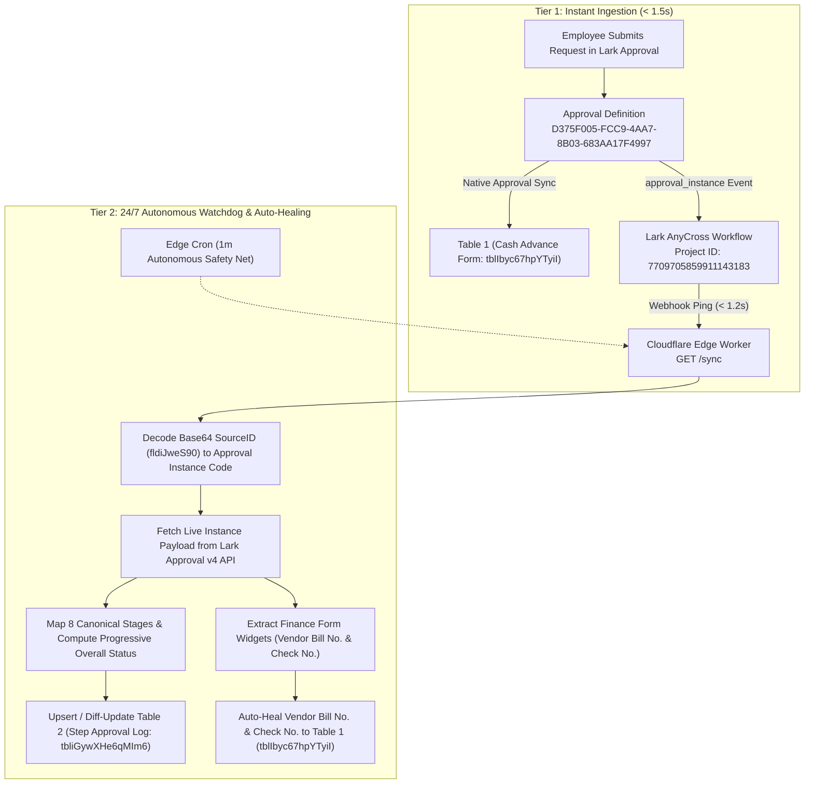

# Lark Cash Advance (Non-Travel) SLA Watchdog & Auto-Healing System
[](https://github.com/markwlsn/cash-advance-non-travel/actions/workflows/ci.yml)
[]()
[]()

Production-grade two-tier serverless architecture synchronizing **Lark Approval v4**, **Lark AnyCross**, **Cloudflare Workers**, and **Lark Base (Bitable)** with instant $< 2\text{s}$ event ingestion and 24/7 autonomous auto-healing, mirroring the **Liquidation (Non-Travel)** production setup 1-to-1.

---

## 1. System Architecture



---

## 2. Core Stack Identifiers

| Parameter | Identifier / Value | Description |
| :--- | :--- | :--- |
| **Lark Base Token** | `ZMxobOBv0aW8AosmOhflq4IagBe` | Cash Advance (Non-Travel) Master Tracker |
| **Table 1 ID (Master)** | `tblIbyc67hpYTyiI` | `Cash Advance Form` (View: `vewIj1OSBd`, 40 columns, native Approval-synced) |
| **Table 2 ID (Step Log)** | `tbliGywXHe6qMIm6` | `Step Approval Log` (View: `vewYFHTdcL`, 47 columns after `SourceID` standardization, 8 stages) |
| **Architecture** | **Strict 2-Table** | Enforced 2-table model mirroring Liquidation (Non-Travel) (`tblaIarx3eSshV6N` / `tbl9kYdGsLsPQzB6`) |
| **Approval Definition Code** | `D375F005-FCC9-4AA7-8B03-683AA17F4997` | `Cash Advance Form (Non-Travel)` (Admin ID `7690379670504460009`) |
| **Dedicated Bot App ID** | `cli_aa74f7f23ab8df04` | `Cash Advance NT Bot` (Dedicated enterprise bot isolated from sibling workflows) |
| **Cloudflare Worker** | `cash-advance-non-travel-watchdog` | Serverless Edge Watchdog (`https://cash-advance-non-travel-watchdog.markwilsongeronilla01.workers.dev/`) |
| **Lark AnyCross Project** | `7709705859911143183` | `Cash Advance NT` (`Cash Advance (Non-Travel) Real-Time Ingestion`) |
| **GitHub Repository** | `markwlsn/cash-advance-non-travel` | Source control & automated GitHub Actions CI (`https://github.com/markwlsn/cash-advance-non-travel`) |

---

## 3. The 8 Monitored Approval Stages

Every Cash Advance request dynamically routes through these 8 canonical stages in Table 2 (`tbliGywXHe6qMIm6`), each tracked with 5 standardized columns (`Approver`, `Start`, `End`, `Duration`, `Action`):

1. **Team Head (if none, enter requester name)** (`c1e48274b814fdce8dc77ddc6be0cd82`) — Line manager endorsement
2. **Department Head** (`2bc64761cd7fa34d3905a13b982c73f2`) — Department head endorsement
3. **Acounting Processing <2000** (`b42dc2a7ceae426ff6a9f683db746ac2`) — Conditional branch 1 (`Total Cash Advance Amount < 2000`; preserves exact Table 2 column prefix)
4. **Accounting Processing > 2000** (`0d47568655d7427088adc32db11e6dea`) — Conditional branch 2 (`Total Cash Advance Amount > 2000`) accounting processing (`Vendor Bill No.` / `Check No.` writable)
5. **Treasury Processing > 2000** (`cc9562b8bb3b689f4051b9f64610f557`) — Conditional branch 2 (`> 2000`) treasury processing (`Vendor Bill No.` / `Check No.` writable)
6. **For Check Releasing > 2000** (`42fbf264c757382bea8706424f06dd8e`) — Conditional branch 2 (`> 2000`) check releasing (`Vendor Bill No.` / `Check No.` writable)
7. **Approval** (`6303e52fcf398a2d8df73b79b144a6d4`) — Conditional branch 3 (`Total Cash Advance Amount == 2000`) approval node
8. **Receipt** (`1750beb4c4c8c6afe329c07dd4ea6028`) — Post-merge initiator confirmation of cash advance receipt

---

## 4. Key Architectural Safeguards

1. **Strict 2-Table Architecture & Native Bitable Types:**
   - Table 1 (`tblIbyc67hpYTyiI`) holds the Approval-synced request overview, amounts, and auto-healed finance control fields (`Vendor Bill No.` `fldykERwG2`, `Check No.` `fldfG1rDCh`).
   - Table 2 (`tbliGywXHe6qMIm6`) tracks all 8 stages using native Type 15 (`Task ID` URL), Type 11 (`Requester` and `<Stage> Approver` User), Type 5 (`<Stage> Start/End` DateTime), Type 20 (`<Stage> Duration` Formula), and Type 3 (`Overall Status` and `<Stage> Action` SingleSelect), with **zero** Type 19 cross-table lookup formula warnings `(!)`.
2. **Type-Aware Diff Engine & Settled Terminal-Row Skipping:**
   - Normalizes enriched Bitable User (`{ id, name, en_name }`) and URL (`[{ type: 'url', text, link }]`) payloads before diffing to eliminate redundant `PUT` calls.
   - Prioritizes newly created rows and skips settled terminal records (`COMPLETED: Cash Advance Released`, `Rejected`, `Recalled`, `Canceled`) so historical backlog never starves new submissions.
3. **Multi-Page Bitable Pagination (`page_size=500`):**
   - Paginates cleanly via `page_token` / `has_more` across Table 1 and Table 2 without silent 100-row truncation.
4. **Zero-Latency In-Memory Token Caching & Subrequest Budget Guard:**
   - Lark `tenant_access_token` is cached in memory until `expire - 120s` (~7,000 seconds).
   - Hard subrequest guard (`subrequestsUsed <= 42` out of Cloudflare Free Tier's 50 limit) gracefully yields excess backlog to the next 1-minute cron cycle.

---

## 5. Local Verification & Schema Standardization

### Run Local Unit & Simulated Integration Tests:
```bash
node test_cloudflare_worker_logic.js
```
Expected output:
```text
Verification Complete: 92/92 Tests Passed
```

### Preview Table 2 Schema Standardization (Dry-Run):
```bash
python configure_table2_schema.py --dry-run
```

### Execute Live Table 2 Schema Standardization (After User Approval):
```bash
# Requires LARK_APP_SECRET in .env or environment
python configure_table2_schema.py
```

### Health Check & Manual Sync (After Cloudflare Deployment):
```bash
curl https://cash-advance-non-travel-watchdog.markwilsongeronilla01.workers.dev/health
curl https://cash-advance-non-travel-watchdog.markwilsongeronilla01.workers.dev/sync
```

See [DEPLOYMENT_PLAN.md](file:///c:/Users/User.MIS/Documents/Cash%20Advance%20(Non-Travel)/DEPLOYMENT_PLAN.md) for the complete 1-to-1 field parity matrix, AnyCross & Lark App configuration instructions, ordered rollout steps, and live E2E test-record verification procedure.
